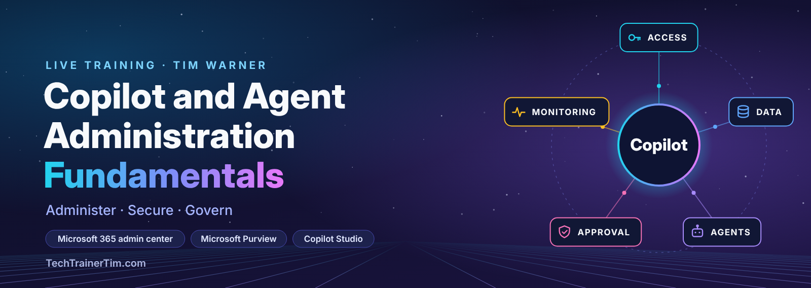
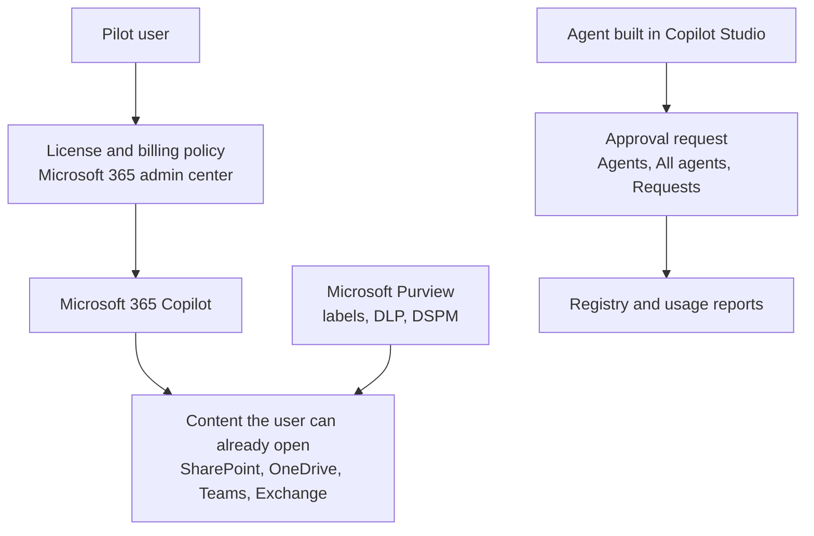

  

# Copilot and Agent Administration Fundamentals

Tim Warner | Pearson Enterprise Live Training | October 27, 2026

**Learn to administer, secure, and govern Microsoft 365 Copilot and the agents people build on it.**
Follow one fictional company, **Contoso, Ltd.**, as its service team rolls out Copilot
and a small service assistant. Every demo answers the same three questions:
**Who can use it? What can it reach? Who answers for it when it changes?**

A Copilot license gives a user the Copilot experience. It does not give that user any
new permission to your files, because Copilot only surfaces organizational data the
user can already view. Most of this course follows from that one idea.

**Attending live?** Tim runs every demo on screen in the Microsoft 365 admin center,
Microsoft Purview, and Copilot Studio. Participate through polls, chat, and the Q&A
widget. You do not need a tenant or an install. Your session's **Resources** widget has
the four PDF handouts and the starter files, and both are in this repository too:
[class handouts](handouts/README.md) and [starter files](starter-files/README.md).

**Practicing afterward?** Follow the learning route below in a lab tenant you are
allowed to change. The [starter files](starter-files/README.md) are synthetic, so there
is nothing real to leak.

**Want every click?** Use the [step-by-step demo tutorials](TUTORIALS.md). Each one
lists numbered actions, what to look for, and why it matters.

## Learning route

| Step | Open | Handout | What you should be able to explain |
| --- | --- | --- | --- |
| 0. Prepare a lab once | [Tutorial 0](TUTORIALS.md#0-prepare-once) | None | Which least-privileged role does each job, and which report to start early. |
| 1. Trace access and adoption | [Tutorial 1](TUTORIALS.md#1-trace-access-and-adoption) | [01](handouts/01-Admin-Portal-Map.pdf), [02](handouts/02-Admin-and-Purview-Walkthrough.pdf) | Why a license, a billing policy, and a usage report are three separate observations. |
| 2. Protect content with DLP | [Tutorial 2](TUTORIALS.md#2-create-a-dlp-policy-for-copilot-in-simulation) | [02](handouts/02-Admin-and-Purview-Walkthrough.pdf), [03](handouts/03-Sample-DLP-and-DSPM-Configurations.pdf) | What a DLP rule for Copilot needs: a location, a condition, and an action. |
| 3. Find oversharing | [Tutorial 3](TUTORIALS.md#3-read-a-data-access-governance-report) | [02](handouts/02-Admin-and-Purview-Walkthrough.pdf), [03](handouts/03-Sample-DLP-and-DSPM-Configurations.pdf) | What a snapshot report shows that an activity report does not, and how to prove a boundary. |
| 4. Build and test an agent | [Tutorial 4](TUTORIALS.md#4-build-and-test-the-starter-agent) | [04](handouts/04-Starter-Agent-Configuration.pdf) | Why the knowledge source you choose changes who can read the content. |
| 5. Approve and operate the agent | [Tutorial 5](TUTORIALS.md#5-approve-and-operate-the-agent) | [04](handouts/04-Starter-Agent-Configuration.pdf), [01](handouts/01-Admin-Portal-Map.pdf) | What approval establishes, who can give it, and who watches the agent afterward. |
| Exercise | [Would you expand this pilot?](TUTORIALS.md#exercise-would-you-expand-this-pilot) | [02](handouts/02-Admin-and-Purview-Walkthrough.pdf), page 3 | How access evidence and ownership decide a rollout, not answer counts. |

The handouts were written October 19, 2026. Read the
[updates since then](handouts/README.md#updates-since-the-handouts-were-written)
before you rely on a detail in them.

> **Currency:** The learning route was checked on **October 25, 2026** against the
> AB-900 study guide dated **October 14, 2026**. The starter agent was rebuilt and its
> tests rerun in the instructor demo tenant on **October 26, 2026**. The
> [observed results](evidence/README.md) include what surprised us.

### How the pieces connect

Licensing decides who gets the Copilot experience. Permissions and Microsoft Purview
decide what it can reach. Approval and monitoring decide which agents reach everyone.
The demos follow that order.

## What is in this repository

- [`TUTORIALS.md`](TUTORIALS.md): every demo as numbered steps, with what to look for and why it matters.
- [`handouts/`](handouts/README.md): the four PDF handouts from your session's Resources widget, byte for byte, plus the updates since October 19.
- [`starter-files/`](starter-files/README.md): the synthetic Contoso service guide, agent instructions, test matrix T01 to T08, and a synthetic sharing report.
- [`evidence/`](evidence/README.md): the instructor's observed run of the starter agent tests, with the date, the agent version, and the surprises.
- [`docs/certify.md`](docs/certify.md): exam AB-900 links and logistics, for anyone who decides to certify.
- [`docs/study-buddy.md`](docs/study-buddy.md): a GitHub Copilot study buddy that writes practice questions, scenario walkthroughs, and study plans.
- [`archive/july-2026/`](archive/july-2026/README.md): the earlier four-hour edition, with study notes, demo scripts, labs, segment folders, practice questions, and PowerShell helpers.
- [`references/`](references/ab900-objectives.md): the exam objectives, Microsoft fictional company names, and the style guide the study buddy uses.
- `scripts/`: the course-home checker and the banner generator. [GitHub Actions](https://github.com/timothywarner-org/ab900/actions/workflows/course-home.yml) runs the checker on every push.

## Lab prerequisites

You need nothing installed to follow the live class. To practice afterward:

- Basic familiarity with Microsoft 365 services (email, SharePoint, Teams).
- A Microsoft 365 lab tenant you are allowed to change, with Microsoft 365 Copilot, Microsoft Purview, and Copilot Studio available. A trial or developer tenant works. See the [tenant setup guide](docs/tenant-setup-guide.md).
- A browser. VS Code with GitHub Copilot is only needed for the [study buddy](docs/study-buddy.md).

Microsoft classifies Global Administrator as a highly privileged role and recommends
limiting it to emergency scenarios where a lower-privileged role cannot be used. For lab
work, prefer the least-privileged role that completes the task: **AI Administrator** for
Copilot and agent governance, **Billing Administrator** for pay-as-you-go setup,
**SharePoint Administrator** for oversharing reports, and **Compliance Administrator** for
Microsoft Purview.

## Admin portals and paths

| Portal | URL |
| --- | --- |
| Microsoft 365 admin center | https://admin.microsoft.com |
| Microsoft Purview portal | https://purview.microsoft.com |
| SharePoint admin center | https://admin.microsoft.com/sharepoint |
| Copilot Studio | https://copilotstudio.microsoft.com |
| Power Platform admin center | https://admin.powerplatform.microsoft.com |
| Microsoft Entra admin center | https://entra.microsoft.com |
| Microsoft Defender portal | https://security.microsoft.com |
| Teams admin center | https://admin.teams.microsoft.com |
| Exchange admin center | https://admin.exchange.microsoft.com |
| Copilot Dashboard | Opened from the Viva Insights app in Microsoft Teams or the Viva Insights web app, **NOT** from a standalone admin URL |

Two portals are retired. The Microsoft Purview compliance portal is superseded by the
Microsoft Purview portal at `purview.microsoft.com`. The Office 365 Security and
Compliance Center is split across the Microsoft Defender portal, the Microsoft Purview
portal, and the Exchange admin center.

| Task | Current path |
| --- | --- |
| Copilot pay-as-you-go billing | admin.microsoft.com > **Copilot** > **Cost management**, then **Classic Billing & usage**. Some Learn pages still say **Copilot** > **Billing & usage**, so use the label your tenant shows. |
| Agent approval queue | admin.microsoft.com > **Agents** > **All agents** > **Requests** |
| Agent inventory | admin.microsoft.com > **Agents** > **All agents** > **Registry** |
| Copilot usage report | admin.microsoft.com > **Reports** > **Usage** > **Microsoft 365 Copilot** > **Copilot** |
| DSPM for AI (the label the exam uses) | purview.microsoft.com > **Solutions** > **DSPM for AI (classic)** |
| DSPM (the unified solution) | purview.microsoft.com > **Solutions** > **DSPM** |
| Data access governance reports | SharePoint admin center > **Reports** > **Data access governance** |

Portal labels change. Each tutorial dates its own check, and the
[handout updates](handouts/README.md#updates-since-the-handouts-were-written) list what
moved since October 19, 2026.

## About the author

**Tim Warner** is a Microsoft MVP, a Microsoft Certified Trainer since 1997, and a
Principal Staff Author at Pluralsight with more than 200 courses and over a million
learners. He teaches live courses for Pearson and O'Reilly, and he builds and ships
MCP servers. His teaching model comes from Richard Feynman: start from first
principles, prove the idea with a working demo, and keep the examples close to real
enterprise work.

You can find his video courses on [Pluralsight](https://www.pluralsight.com/authors/tim-warner),
short tutorials on [YouTube](https://www.youtube.com/@TechTrainerTim), more course
repositories on [GitHub](https://github.com/timothywarner-org), and everything else
at [TechTrainerTim.com](https://techtrainertim.com). Connect with him on
[LinkedIn](https://www.linkedin.com/in/timothywarner).

## License

The code and documents are released under the [MIT License](LICENSE). See
[NOTICE.md](NOTICE.md) for trademarks and source attribution. Questions about the
course materials are welcome as [issues](https://github.com/timothywarner-org/ab900/issues).
